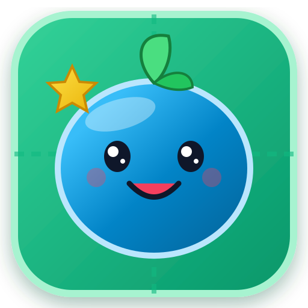

# 🌿 Pebble Pals: Territory Quest! ⭐

A vibrant, kid-friendly, offline-capable **Progressive Web App (PWA)** inspired by the ancient game of Go, simplified and designed specifically for kids aged 6–12.



---

## 🎮 Game Overview

In **Pebble Pals**, the sole objective is to **occupy and control the most garden spaces on the board**. 

### 📊 Scoring Rules

$$\text{Total Score} = \underbrace{(\text{Pebbles on Board} \times 1)}_{\text{Occupied Spots}} + \underbrace{(\text{Enclosed \& Splash Spaces} \times 1)}_{\text{Captured Spaces}} + \underbrace{(\text{Captured Enemy Pebbles} \times 2)}_{\text{Surrounding Capture Bonus}}$$

- **📍 Occupied Pebble Spot (+1 Point):** Every pebble standing on the board claims 1 point.
- **🏡 Captured Space (+1 Point):** Every empty space walled off by your garden fences without needing a stone.
- **🌊 Splash Territory (+1 Point):** The ground vacated by captured enemy pebbles splashes into your team's color.
- **💥 Surround Capture Bonus (+2 Points!):** When you surround an opponent's pebble on all corners/sides to take its last breath, you score **2 Points per captured pebble** (resulting in a **3-Point Net Gain** with the splashed space!).

---

## ✨ Features

- **Dual Board Representation (Toggle Anytime):**
  - **🌿 Garden Boxes (Default):** Tactile earth planter tiles with grass textures, wooden borders, and 3D pebble placement.
  - **🪵 Classic Go Lines:** Authentic Shin-Kaya wood grain with crisp intersection lines and Star Points (*Hoshi*).
- **Multiple Board Sizes:** `5x5` (Quick, 25 spaces), `7x7` (Standard, 49 spaces), and `9x9` (Big Quest, 81 spaces).
- **Danger Shake (Atari Alert):** Pebbles with only 1 breathing space remaining visibly tremble, sweat droplets, and display a pulsing red `!` badge.
- **Kid-Friendly Territory Guard:** Prevents accidental placement in safe, 100% enclosed territory (with double-tap override).
- **6 Colorblind-Accessible Pebble Themes:**
  1. 🌊 **Ocean Blue** (`#0284C7`) — *Bubbles* (Happy round eyes, starfish emblem)
  2. 🌸 **Coral Red** (`#E11D48`) — *Pip* (Star pupils, coral blossom emblem)
  3. ☀️ **Sunny Gold** (`#EAB308`) — *Sunny* (Winking eye & tongue, sunbeam emblem)
  4. 🍀 **Emerald Green** (`#16A34A`) — *Sprout* (Cool nerd glasses, four-leaf clover)
  5. 💎 **Royal Purple** (`#9333EA`) — *Sparkle* (Diamond sparkle eyes, crystal emblem)
  6. 🐼 **Midnight Slate** (`#1E293B`) — *Zen Panda* (Panda eye patches, bamboo emblem)
- **Multiplayer & Teams:**
  - **1v1 Duel:** Human vs Human or Human vs Smart AI Bot.
  - **3-Way Free-For-All:** 3 distinct colors. Last-breath attacker claims the capture splash.
  - **4-Way Free-For-All:** 4 distinct colors.
  - **2v2 Team Battles:** Team 1 (P1 & P3) vs Team 2 (P2 & P4). Teammates place the **same color pebbles**, sharing breathing spaces and joint territory!
- **📖 Master Bao's Illustrated Rule Book:** 6 illustrated chapters with tactile mini-board diagrams, interactive pagination, and tips.
- **🎓 Master Bao's 4 Story Lessons:** Interactive tutorials teaching breathing room, holding hands, pop & splash captures, and building fences.
- **🏆 Trophy Room:** 10 unlockable kid badges and persistent lifetime stats in `localStorage`.
- **🔊 Web Audio API Synthesizer:** Built-in zero-dependency sound effects (pop, capture splash, boing, atari chime, fanfare victory, page flip).
- **📱 Offline PWA:** Installable directly from the browser on desktop, iPad/tablet, or mobile with `manifest.json` and `sw.js`.

---

## 🚀 Quick Start

### 1. Clone the Repository
```bash
git clone https://github.com/sunilkks0507/pebble-pals.git
cd pebble-pals
```

### 2. Start the Local Server
```bash
npm start
```
Or with Node directly:
```bash
node server.js
```

### 3. Open in Browser
Visit **[http://localhost:3000](http://localhost:3000)** in any modern browser!

---

## 🛠️ Architecture

```
pebble-pals/
├── index.html          # Semantic layout, live HUD, SVG symbols, modals
├── styles.css          # Responsive design, tactile garden boxes, classic lines
├── manifest.json       # PWA manifest
├── sw.js               # Service Worker with offline cache-first strategy
├── server.js           # Lightweight zero-dependency HTTP server
├── icons/              # SVG vector badges & PWA icons
└── js/
    ├── audio.js        # Web Audio API procedural sound synthesizer
    ├── engine.js       # Core Go rules, liberties, groups, flood-fill territory
    ├── ai.js           # Heuristic AI bot with territory delta evaluation
    ├── tutorial.js     # Master Bao's interactive story lessons
    ├── trophies.js     # Achievement badges and persistent stats tracker
    └── app.js          # Main UI orchestrator, dual board views, rule book
```

---

## 📄 License
MIT License. Free for kids, educators, and gardeners everywhere! 🌸
